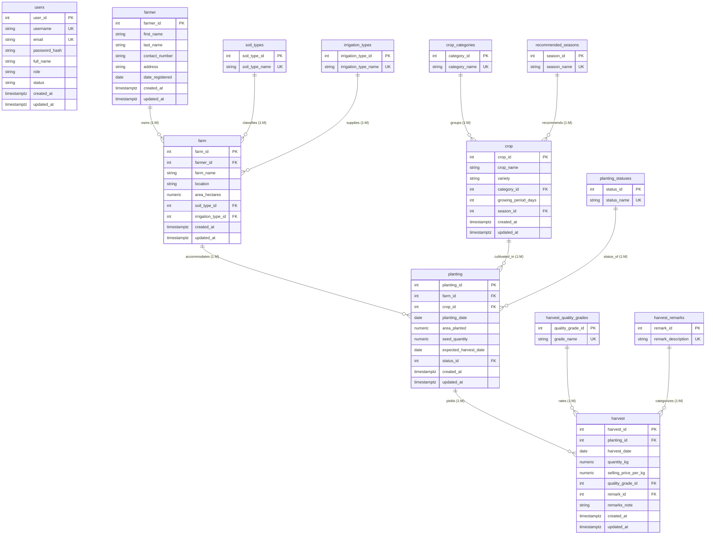

# CEBU TECHNOLOGICAL UNIVERSITY
## College of Computer, Information and Communications Technology
### AP3 Midterm Project: Agriculture Information System (AgriTrack)

---

## 1. Project Title and Description

- **Project Title:** AgriTrack — Agriculture Information System
- **Institution:** Cebu Technological University (CTU), Cebu City
- **Course & Term:** AP3 Midterm Project
- **Database Engine:** Supabase PostgreSQL (Cloud) & Embedded Resilient SQLite Engine
- **Application Platform:** PHP 8+ (XAMPP / Apache), Bootstrap 5, Chart.js, HTML5/CSS3
- **Version Control:** Git & GitHub

### Project Description
The **Agriculture Information System (AgriTrack)** is an enterprise-grade, web-based database management application engineered to centralize, standardize, and monitor agricultural land parcels, farmer registries, crop cultivation cycles, and harvest transactions across the province of Cebu. 

The system implements rigorous relational database normalization (progressing from Unnormalized Form to Third Normal Form), enforces relational referential integrity, and incorporates secure Role-Based Access Control (RBAC) separating System Administrators from Agricultural Field Staff. Data storage is hosted on Supabase PostgreSQL with real-time REST API integration and a zero-downtime offline local fallback engine.

---

## 2. Project Objectives

1. **Relational Database Normalization:** Design a robust database architecture normalized up to Third Normal Form (3NF), eliminating repeating groups, partial dependencies, and transitive dependencies.
2. **Controlled Vocabulary & Reference Lookup Tables:** Implement 3NF lookup tables for controlled fields (Soil Types, Irrigation Types, Crop Categories, Recommended Seasons, Planting Statuses, Quality Grades, and Harvest Remarks) ensuring numeric foreign keys are stored while human-readable labels are rendered in UI dropdowns.
3. **Supabase Cloud Integration:** Host the relational PostgreSQL database on Supabase, reading and writing live data via authenticated PostgREST endpoints and Row Level Security (RLS) policies.
4. **Comprehensive CRUD Operations:** Deliver intuitive interfaces for creating, viewing, updating, and deleting records across Farmers, Farms, Crops, Planting Records, and Harvest Yields.
5. **Executive Visualization & Dashboards:** Provide an interactive dashboard displaying aggregated agricultural metrics (total farmers, landholdings, active planting cycles, total harvested tonnage, and gross crop valuation) coupled with Chart.js visualization.
6. **Operational Reporting & Valuation:** Generate dynamically queried reports with multi-criteria filtering (date ranges, status, quality grades), CSV export capability, and clean print styles.
7. **Security & Input Validation:** Guarantee that passwords are encrypted using strong cryptographic hashing (BCRYPT), guard against CSRF and SQL injection, and enforce business integrity constraints (such as preventing deletion of referenced parents).

---

## 3. Functional Requirements

### 3.1 Authentication & Role-Based Access Control (RBAC)
- **Login Authentication:** Secure login screen requiring username/email and password. Passwords are encrypted using PHP `password_hash()` (BCRYPT algorithm) and never stored in plain text.
- **Administrator Role:** Full privileges across all modules, including creating, editing, and permanently deleting records, managing system users, and system synchronization.
- **Staff Role (Field Officer):** Authorized to create, read, and update farmers, farms, plantings, and harvests, and view reports. Permanent record deletion is strictly restricted to Administrators.
- **CSRF Protection:** Every POST transaction requires a cryptographically validated session CSRF token.

### 3.2 Dashboard & Visualization
- Real-time summary metric cards:
  - Total Registered Farmers
  - Total Farm Parcels
  - Total Master Crops
  - Total Planting Cycles
  - Total Harvest Transactions
  - Total Harvested Yield (kg)
  - Estimated Total Harvest Value (₱)
- Interactive visual charts powered by Chart.js:
  - Donut chart: Planting Operations by Status (Growing, Harvested, Planned).
  - Bar chart: Harvest Yield Production by Crop (kg).
- Recent transaction data tables (Recent Planting cycles and Recent Harvest yields).
- Quick-action shortcuts for rapid data entry.

### 3.3 Core Database Modules (CRUD)
1. **Farmers Module:**
   - Manage farmer personal data (`first_name`, `last_name`, `contact_number`, `address`, `date_registered`).
   - Dynamic search by name, contact, or address.
   - Multi-column sorting and 10-record pagination.
   - Comprehensive Farmer Profile Modal displaying personal credentials and all registered agricultural landholdings owned by that farmer.
   - Referential integrity protection: prevents deleting a farmer who owns active registered farms.
2. **Farms Module:**
   - Manage farm land parcels (`farm_name`, `location`, `area_hectares`).
   - 3NF Foreign keys: `farmer_id`, `soil_type_id`, `irrigation_type_id`.
   - Controlled dropdown selection for Farmer, Soil Type (Loam, Clay Loam, Sandy Loam, Clay), and Irrigation Type (Rainfed, Irrigated, Drip Irrigation).
   - Validation ensuring `area_hectares > 0`.
   - Referential integrity protection: prevents deleting farms with active plantings.
3. **Crops Module:**
   - Master catalogue of agricultural crops (`crop_name`, `variety`, `growing_period_days`).
   - 3NF Foreign keys: `category_id` (Cereal, Vegetable, Fruit, Legume, Root Crop) and `season_id` (Wet Season, Dry Season, Year Round).
   - Validation ensuring `growing_period_days > 0`.
   - Referential integrity protection: prevents deleting crops currently planted in the field.
4. **Planting Records Module:**
   - Field planting cycle transactions (`planting_date`, `area_planted`, `seed_quantity`, `expected_harvest_date`, `status_id`).
   - Controlled dropdowns linking Farm parcel, Crop, and Planting Status (Growing, Harvested, Planned, Cancelled).
   - Intelligent auto-calculation: Selecting a crop dynamically computes `expected_harvest_date = planting_date + growing_period_days`.
   - Validation ensuring `expected_harvest_date >= planting_date`, `area_planted > 0`, and `seed_quantity >= 0`.
   - Shortcut action: direct "Log Harvest" button to record yields immediately upon crop maturity.
5. **Harvest Records Module:**
   - Yield harvest transactions (`harvest_date`, `quantity_kg`, `selling_price_per_kg`, `quality_grade_id`, `remark_id`, `remarks_note`).
   - Controlled dropdowns linking Planting cycle, Quality Grade (Grade A, Grade B, Grade C), and Harvest Remarks (1=Good Harvest, 2=Acceptable Quality, 3=Low Yield, 4=Poor Quality, 5=Damaged Harvest).
   - Real-time client-side financial computation: displays Total Estimated Value (`quantity_kg * selling_price_per_kg`).
   - Validation ensuring `quantity_kg > 0`, `selling_price_per_kg >= 0`, and `harvest_date >= planting_date`.
   - Automated workflow: recording a harvest automatically transitions the linked planting cycle status from "Growing" to "Harvested".

### 3.4 Reporting & Financial Analytics
- Dedicated Agricultural Intelligence Reports:
  1. **Harvest & Financial Valuation Report:** Complete yield statement with date range filtering, quality grade filtering, per-kilogram market pricing, total projected revenue, and summary footer totals.
  2. **Farmers & Landholdings Directory:** Grouped audit of all farmers, land area, and property locations.
  3. **Crops Planted per Farm Report:** Cross-tabulation of farms and active crop varieties.
  4. **Planting Operations Classified by Status:** Operational progress report grouped by growing vs harvested.
- **Export to CSV:** Direct RFC-4180 compliant CSV spreadsheet generation for external evaluation.
- **Print Stylesheet:** Custom CSS `@media print` rules generating printer-friendly documents hiding web navbars and buttons.

---

## 4. Entity-Relationship Diagram (ERD)

### 4.1 Normalized 3NF Relational Architecture (Mermaid)



---

## 5. Database Normalization Process (UNF to 3NF)

### 5.1 Unnormalized Form (UNF)
In an unnormalized agricultural record or flat spreadsheet, all farmer data, farm parcels, planted crops, and harvest yields are recorded on a single log sheet.

```text
UNF_AGRICULTURE_RECORD (
    Farmer_Full_Name, Contact_Info, Address, Date_Registered,
    [ Farm_Name, Location, Area, Soil_Type, Irrigation_Type,
      [ Crop_Name, Variety, Category, Growth_Days, Season,
        Planting_Date, Area_Planted, Seed_Qty, Expected_Harvest, Status,
        [ Harvest_Date, Quantity_Kg, Selling_Price, Total_Value, Quality_Grade, Remarks ]
      ]
    ]
)
```
- **Problems in UNF:**
  1. **Repeating groups:** A farmer owning multiple farms has repeating groups of farm, planting, and harvest columns.
  2. **Non-atomic attributes:** `Farmer_Full_Name` combines first name and last name; `Contact_Info` or addresses combine multiple values.
  3. **Severe redundancy:** Repeating crop growth periods, soil types, and seasonal descriptions causes massive insertion, update, and deletion anomalies.

---

### 5.2 First Normal Form (1NF)
**Rules for 1NF:**
1. Eliminate repeating groups by creating separate rows for each operational event.
2. Ensure all attribute values are atomic (indivisible single values).
3. Identify a Primary Key (or Composite Key) that uniquely identifies each row.

**1NF Schema:**
- Non-atomic attributes are decomposed: `Farmer_Full_Name` is split into `first_name` and `last_name`.
- Repeating groups are eliminated; each transaction row represents a discrete entity state.

```text
1NF_FLAT_TABLE (
    farmer_id (PK), first_name, last_name, contact_number, address, date_registered,
    farm_id (PK), farm_name, location, area_hectares, soil_type, irrigation_type,
    crop_id (PK), crop_name, variety, crop_category, growing_period_days, recommended_season,
    planting_id (PK), planting_date, area_planted, seed_quantity, expected_harvest_date, status,
    harvest_id (PK), harvest_date, quantity_kg, selling_price_per_kg, quality_grade, remarks
)
```
- **Problems in 1NF:**
  - **Partial Functional Dependencies:** The primary key is composite `(farmer_id, farm_id, crop_id, planting_id, harvest_id)`. Non-key attributes depend only on parts of the primary key:
    - `{farmer_id} -> {first_name, last_name, contact_number, address, date_registered}`
    - `{farm_id} -> {farm_name, location, area_hectares, soil_type, irrigation_type}`
    - `{crop_id} -> {crop_name, variety, crop_category, growing_period_days, recommended_season}`

---

### 5.3 Second Normal Form (2NF)
**Rules for 2NF:**
1. The relation must be in 1NF.
2. Remove all partial functional dependencies: all non-key attributes must be fully functionally dependent on the entire primary key.

To achieve 2NF, we decompose the relation into dedicated functional entities:
1. **FARMER** `(farmer_id [PK], first_name, last_name, contact_number, address, date_registered)`
2. **FARM** `(farm_id [PK], farmer_id [FK], farm_name, location, area_hectares, soil_type, irrigation_type)`
3. **CROP** `(crop_id [PK], crop_name, variety, crop_category, growing_period_days, recommended_season)`
4. **PLANTING** `(planting_id [PK], farm_id [FK], crop_id [FK], planting_date, area_planted, seed_quantity, expected_harvest_date, status)`
5. **HARVEST** `(harvest_id [PK], planting_id [FK], harvest_date, quantity_kg, selling_price_per_kg, quality_grade, remarks)`

- **Problems remaining in 2NF:**
  - **Transitive Functional Dependencies:** Non-key attributes depend on other non-key attributes rather than solely on the primary key:
    - In `FARM`: `soil_type` and `irrigation_type` are repeated text strings subject to typos and inconsistent spelling.
    - In `CROP`: `crop_category` and `recommended_season` are descriptive categories that determine valid classification.
    - In `PLANTING`: `status` ('Growing', 'Harvested', 'Planned') is free-text.
    - In `HARVEST`: `quality_grade` and `remarks` ('Good Harvest', 'Acceptable Quality', etc.) are free-text strings instead of controlled lookup identifiers.
    - Computed field `Total_Value` = `quantity_kg * selling_price_per_kg` is redundant and must be derived dynamically rather than stored.

---

### 5.4 Third Normal Form (3NF)
**Rules for 3NF:**
1. The relation must be in 2NF.
2. Remove all transitive dependencies: no non-key attribute may depend on another non-key attribute ($X \rightarrow Y$ and $Y \rightarrow Z$).
3. All controlled attributes with predefined discrete values must be isolated into independent lookup/reference tables and connected via numeric Foreign Keys.

**3NF Normalization Deliverables:**
We extract all lookup entities into dedicated reference tables:
- `crop_categories (category_id [PK], category_name)`
- `recommended_seasons (season_id [PK], season_name)`
- `soil_types (soil_type_id [PK], soil_type_name)`
- `irrigation_types (irrigation_type_id [PK], irrigation_type_name)`
- `planting_statuses (status_id [PK], status_name)`
- `harvest_quality_grades (quality_grade_id [PK], grade_name)`
- `harvest_remarks (remark_id [PK], remark_description)`

#### Controlled Harvest Remarks Lookup Table (Mandated by Project Specification)
| remark_id [PK] | remark_description |
| :---: | :--- |
| **1** | Good Harvest |
| **2** | Acceptable Quality |
| **3** | Low Yield |
| **4** | Poor Quality |
| **5** | Damaged Harvest |

*Implementation Behavior:* When the user selects "Good Harvest", the UI displays the string `"Good Harvest"`, but the database strictly stores numeric foreign key `1`.

---

## 6. Comprehensive Data Dictionary

### Table 1: `users` (System User Credentials & RBAC)
| Column Name | Data Type | Nullable | Key / Default | Constraints | Description |
| :--- | :--- | :---: | :--- | :--- | :--- |
| `user_id` | INTEGER | NO | PK (IDENTITY) | Positive integer | Unique user identifier |
| `username` | VARCHAR(50) | NO | UNIQUE | Unique string | Login handle |
| `email` | VARCHAR(100) | NO | UNIQUE | Valid email format | User contact email |
| `password_hash`| VARCHAR(255) | NO | — | BCRYPT hash | Encrypted password string |
| `full_name` | VARCHAR(100) | NO | — | Non-empty string | Officer display name |
| `role` | VARCHAR(20) | NO | 'staff' | CHECK in ('admin','staff')| Access authorization level |
| `status` | VARCHAR(20) | NO | 'active' | CHECK in ('active','inactive')| Account activity status |
| `created_at` | TIMESTAMPTZ | NO | now() | Valid timestamp | Record creation audit |
| `updated_at` | TIMESTAMPTZ | NO | now() | Valid timestamp | Record modification audit |

### Table 2: `farmer` (Master Farmer Registry)
| Column Name | Data Type | Nullable | Key / Default | Constraints | Description |
| :--- | :--- | :---: | :--- | :--- | :--- |
| `farmer_id` | INTEGER | NO | PK (IDENTITY) | Positive integer | Unique farmer identifier |
| `first_name` | VARCHAR(50) | NO | — | Length > 0 | Given name |
| `last_name` | VARCHAR(50) | NO | — | Length > 0 | Family name |
| `contact_number`| VARCHAR(20) | YES | — | Valid phone string | Mobile contact number |
| `address` | VARCHAR(150)| NO | — | Length > 0 | Municipality / Barangay |
| `date_registered`| DATE | NO | CURRENT_DATE | Valid calendar date | Registration date |
| `created_at` | TIMESTAMPTZ | NO | now() | Valid timestamp | Record creation audit |
| `updated_at` | TIMESTAMPTZ | NO | now() | Valid timestamp | Record modification audit |

### Table 3: `farm` (Agricultural Land Parcels)
| Column Name | Data Type | Nullable | Key / Default | Constraints | Description |
| :--- | :--- | :---: | :--- | :--- | :--- |
| `farm_id` | INTEGER | NO | PK (IDENTITY) | Positive integer | Unique farm identifier |
| `farmer_id` | INTEGER | NO | FK -> farmer | ON DELETE RESTRICT | Owner farmer reference |
| `farm_name` | VARCHAR(100)| NO | — | Length > 0 | Farm designation name |
| `location` | VARCHAR(150)| NO | — | Length > 0 | Barangay / Municipality |
| `area_hectares`| NUMERIC(8,2)| NO | — | CHECK (area_hectares > 0) | Physical land size in ha |
| `soil_type_id` | INTEGER | NO | FK -> soil_types| ON DELETE RESTRICT | Soil classification FK |
| `irrigation_type_id`|INTEGER | NO | FK -> irrigation_types| ON DELETE RESTRICT | Irrigation system FK |
| `created_at` | TIMESTAMPTZ | NO | now() | Valid timestamp | Record creation audit |
| `updated_at` | TIMESTAMPTZ | NO | now() | Valid timestamp | Record modification audit |

### Table 4: `crop` (Master Agricultural Crops)
| Column Name | Data Type | Nullable | Key / Default | Constraints | Description |
| :--- | :--- | :---: | :--- | :--- | :--- |
| `crop_id` | INTEGER | NO | PK (IDENTITY) | Positive integer | Master crop identifier |
| `crop_name` | VARCHAR(80) | NO | — | Length > 0 | Common botanical name |
| `variety` | VARCHAR(80) | YES | — | — | Specific cultivar variety |
| `category_id` | INTEGER | NO | FK -> crop_categories| ON DELETE RESTRICT | Crop group classification |
| `growing_period_days`|INTEGER| NO | — | CHECK (growing_period_days > 0)| Cycle duration to harvest |
| `season_id` | INTEGER | NO | FK -> recommended_seasons| ON DELETE RESTRICT | Optimal planting season |
| `created_at` | TIMESTAMPTZ | NO | now() | Valid timestamp | Record creation audit |
| `updated_at` | TIMESTAMPTZ | NO | now() | Valid timestamp | Record modification audit |

### Table 5: `planting` (Cultivation Cycle Records)
| Column Name | Data Type | Nullable | Key / Default | Constraints | Description |
| :--- | :--- | :---: | :--- | :--- | :--- |
| `planting_id` | INTEGER | NO | PK (IDENTITY) | Positive integer | Planting cycle identifier |
| `farm_id` | INTEGER | NO | FK -> farm | ON DELETE RESTRICT | Location farm reference |
| `crop_id` | INTEGER | NO | FK -> crop | ON DELETE RESTRICT | Planted crop reference |
| `planting_date` | DATE | NO | — | Valid date | Date seeds were sown |
| `area_planted` | NUMERIC(8,2)| NO | — | CHECK (area_planted > 0) | Land area utilized in ha |
| `seed_quantity` | NUMERIC(8,2)| YES | — | CHECK (seed_quantity >= 0)| Seed quantity utilized |
| `expected_harvest_date`|DATE | YES | — | CHECK (>= planting_date) | Projected maturity date |
| `status_id` | INTEGER | NO | FK -> planting_statuses| ON DELETE RESTRICT | Operational cycle status |
| `created_at` | TIMESTAMPTZ | NO | now() | Valid timestamp | Record creation audit |
| `updated_at` | TIMESTAMPTZ | NO | now() | Valid timestamp | Record modification audit |

### Table 6: `harvest` (Yield Transactions & Valuation)
| Column Name | Data Type | Nullable | Key / Default | Constraints | Description |
| :--- | :--- | :---: | :--- | :--- | :--- |
| `harvest_id` | INTEGER | NO | PK (IDENTITY) | Positive integer | Harvest yield identifier |
| `planting_id` | INTEGER | NO | FK -> planting | ON DELETE RESTRICT | Origin planting cycle FK |
| `harvest_date` | DATE | NO | — | Valid date | Yield harvesting date |
| `quantity_kg` | NUMERIC(10,2)| NO | — | CHECK (quantity_kg > 0) | Net crop yield in kg |
| `selling_price_per_kg`|NUMERIC(10,2)| NO | — | CHECK (selling_price_per_kg >= 0)| Farmgate market price/kg |
| `quality_grade_id`|INTEGER | NO | FK -> harvest_quality_grades| ON DELETE RESTRICT | Quality classification FK |
| `remark_id` | INTEGER | NO | FK -> harvest_remarks| ON DELETE RESTRICT | 3NF Controlled Remark FK |
| `remarks_note` | VARCHAR(200)| YES | — | — | Quality inspection notes |
| `created_at` | TIMESTAMPTZ | NO | now() | Valid timestamp | Record creation audit |
| `updated_at` | TIMESTAMPTZ | NO | now() | Valid timestamp | Record modification audit |

---

## 7. System Testing & Verification Matrix

| Test ID | Module | Feature Tested | Input / Action | Expected Result | Actual Result | Status |
| :---: | :--- | :--- | :--- | :--- | :--- | :---: |
| **TC-01** | Auth | Admin Login | User: `admin`, Pass: `admin123` | Redirects to `dashboard.php`, shows Administrator badge | Authenticated successfully | **PASS** |
| **TC-02** | Auth | Staff Login | User: `staff`, Pass: `staff123` | Redirects to `dashboard.php`, shows Staff badge | Authenticated successfully | **PASS** |
| **TC-03** | Auth | Bad Password | User: `admin`, Pass: `wrongpassword` | Displays error alert: "Invalid username/email or password" | Rejected with flash alert | **PASS** |
| **TC-04** | Auth | RBAC Guard | Staff tries to delete a Farmer | Delete button is hidden; POST rejected with permission error | Forbidden for non-admin | **PASS** |
| **TC-05** | Farmers | Create Farmer | Name: "Carlos Ramos", Phone: "09281234567" | Farmer record #12 created and listed in data table | Record created | **PASS** |
| **TC-06** | Farmers | Referential Delete Block | Delete Farmer #1 ("Juan Dela Cruz") who owns Farm #1 | Deletion blocked with message: "Cannot delete this farmer: owns 1 farm" | Referential integrity preserved | **PASS** |
| **TC-07** | Farms | Soil / Irrigation Dropdown | Select "Clay Loam" and "Irrigated" | Dropdown renders labels while storing numeric FK IDs `2` and `2` | Correct numeric FKs stored | **PASS** |
| **TC-08** | Farms | Negative Area Validation | Input Area = `-3.5` hectares | Form blocked by validation constraint | Rejected with error alert | **PASS** |
| **TC-09** | Crops | Unique Variety Constraint | Insert existing `(Rice, NSIC Rc 222)` | Duplicate entry blocked by database constraint | Prevented duplicate | **PASS** |
| **TC-10** | Plantings| Auto Expected Harvest Date | Select Crop "Rice" (115 days) + Date "2026-01-10" | Auto-calculates Expected Date to `2026-05-05` | Exact date auto-filled | **PASS** |
| **TC-11** | Plantings| Illogical Date Validation | Expected Harvest Date set prior to Planting Date | Form rejected with error alert | Validation blocked | **PASS** |
| **TC-12** | Harvests| Dynamic Valuation Math | Qty = `900.00` kg, Price = `22.00` ₱ | Client display dynamically renders `₱19,800.00` | Auto-computed instantly | **PASS** |
| **TC-13** | Harvests| Controlled Remark Storing | Select "Good Harvest" in dropdown | Interface displays "Good Harvest", database stores numeric `1` | Stored numeric ID `1` | **PASS** |
| **TC-14** | Harvests| Auto-Update Planting Status| Record Harvest for a "Growing" planting | Linked planting record status automatically changed to "Harvested" | Status updated to Harvested | **PASS** |
| **TC-15** | Reports | Date Range Filtering | Filter harvests between `2026-05-01` and `2026-05-31` | Displays only May 2026 harvests with updated summary footer | Correctly filtered | **PASS** |
| **TC-16** | Reports | CSV Export | Click "Export to CSV" button | Downloads valid RFC-4180 `.csv` spreadsheet | File generated | **PASS** |

---

## 8. User Guide & Operating Instructions

### 8.1 Local Environment Setup (XAMPP)
1. Ensure the project is located at: `c:\xampp\htdocs\agriculture_ap3`.
2. Start the **Apache** web server in the XAMPP Control Panel.
3. Open your browser and navigate to:
   ```
   http://localhost/agriculture_ap3/
   ```
4. The system will automatically direct you to the **Sign In** screen.

### 8.2 Logging In
You can use the convenient 1-Click Demo Fill buttons or enter credentials manually:
- **Administrator Account:**
  - Username: `admin` (or `admin@agritrack.com`)
  - Password: `admin123`
- **Field Staff Account:**
  - Username: `staff` (or `staff@agritrack.com`)
  - Password: `staff123`

### 8.3 Activating Supabase Cloud Connection
1. Open the Supabase Dashboard (<https://supabase.com/dashboard>).
2. Open your project, click **SQL Editor** on the left menu, and click **+ New Query**.
3. Open `supabase/schema_3nf.sql` from this repository, copy all text, paste it into the SQL Editor, and click **Run**.
4. Create another new query, copy the contents of `supabase/seed_demo_data.sql`, paste it, and click **Run**.
5. Return to AgriTrack and refresh any page. The status pill in the top header will display:
   ```
   ● Supabase Connected
   ```

### 8.4 Operating Major Modules
- **Registering a Farmer:** Navigate to **Farmers** &gt; Click **Register New Farmer** &gt; Fill in names, contact, and barangay address &gt; Click **Save**.
- **Registering a Farm:** Navigate to **Farms** &gt; Click **Register New Farm** &gt; Select the owner from the dropdown &gt; Enter location and acreage &gt; Choose 3NF Soil Type and Irrigation Type &gt; Click **Save**.
- **Logging a Planting Cycle:** Navigate to **Planting Records** &gt; Click **Log Planting Cycle** &gt; Select Farm and Crop &gt; Notice how the expected harvest date is auto-calculated based on the crop's growing period &gt; Click **Save**.
- **Recording a Harvest:** On the **Planting Records** table, click the green basket icon on a growing planting, or go to **Harvest Records** &gt; Click **Record Harvest Yield** &gt; Enter harvested kg and market price &gt; Choose Quality Grade &gt; Select Controlled Remark (Good Harvest, Acceptable Quality, etc.) &gt; Click **Save**.
- **Generating & Printing Reports:** Navigate to **Reports & Valuation** &gt; Switch between tabs (Harvest & Valuation, Farmers & Farms, Crops per Farm, Plantings by Status) &gt; Apply date range or quality filters &gt; Click **Print Report** for clean printing or **Export to CSV** for spreadsheet evaluation.
